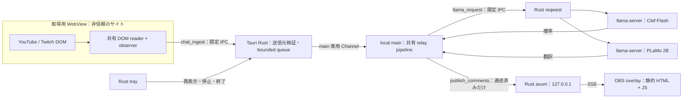

# OBS コメント中継デスクトップアプリ — 技術選定・アーキテクチャ設計書

- 日付: 2026-11-11
- 状態: 設計案（実装前レビュー用。実装・パッケージ生成・配布は未実施）
- 要求: [obs-comment-app-requirements](2026-11-11-obs-comment-app-requirements.md)。今回のユーザー指示を優先し、同書 §7 の未決事項を本書 §3 で解決する。
- 関連: [既存拡張の設計](2026-10-28-chrome-ai-extensions-design.md)、[native](../../native.md)、[llama-server](../../llama-server.md)、[errors](../../errors.md)、[quality](../../quality.md)
- 調査した入力: `feat/obs-comment-relay`、HEAD `0e8ba3239664228d7ec4c9a0edf67f2b3e1c36b6`。開始時の作業ツリーは clean。`origin/main` との merge-base は `3a96317603cdfc95c0e9fd125cd35a8c5d627165`。
- 表記: 「（判断）」は設計者の決定であり、ユーザーが上書きできる。「要検証」は採用方式を保留する意味ではなく、その方式の実装・受け入れを進める前に必要な技術検証を表す。新しい予算・上限は設計値であり、実測値とは区別する。

## 1. 何を作るか、なぜ作るか

配信者が OBS Browser Source に URL を登録するだけで、YouTube または Twitch のライブチャットを、荒らし判定と日本語翻訳を通して画面に出せるアプリを作る。処理は **DOM 取得 → Clef-Flash の有害判定 → 通過した本文の PLaMo 翻訳 → ローカル SSE 配信** に絞る。

推論モデルは `clef-flash` と `plamo-3-translate-2b` の 2 本だけにする。Gemma、ASR、ジャンル推定、要約、字幕への yield、フィードバック学習、バッジ表示、配信者別ルール、ネタバレ・質問・重要度などの多カテゴリ分類は持ち込まない。Clef の「分類」は有害／通過の 2 値であり、PLaMo に分類をさせない。

Tauri と OS の WebView を使い、Chromium、Node.js、Python のランタイムは同梱しない。アプリを起動しただけでは取得ページも llama-server も起動しない（判断）。配信開始後はコントロール画面を閉じても取得・処理・配信を継続し、トレイの「終了」で明示的に終了する。

初版は **同時に 1 配信、macOS arm64** に絞る（判断）。複数サイトの同時集約、サービス／ログイン項目への登録、自動更新、オーバーレイ編集機能は対象外とする。チャットを読む WebView 自体にはサイトへの通信が発生する。「外部に送らない」は、読み取った本文・翻訳・配信 URL を推論／分析サービスへ再送しないという意味であり、サイトページの通常通信をゼロとする意味ではない。

## 2. 技術選定とバージョンの根拠

### 2.1 決定表

| 項目         | 決定                                                                                                         | 根拠・比較                                                                                                                                                                          |
| ------------ | ------------------------------------------------------------------------------------------------------------ | ----------------------------------------------------------------------------------------------------------------------------------------------------------------------------------- |
| アプリ       | `@chrome-toolbox/obs-comment-relay`、`packages/obs-comment-relay/`（判断）                                   | `starter.runtime: desktop`。アプリ間 import をせず、共有ライブラリに依存する。`pnpm app:new -- --kind desktop --name obs-comment-relay` を実装時の生成入口にする                    |
| Desktop      | Rust `tauri = =2.12.2`、`tauri-build = =2.7.1`                                                               | Desktop の `Cargo.toml.template` と `Cargo.lock.template` が一致。フロント API と CLI の番号を同一だと仮定しない                                                                    |
| フロント     | `@tauri-apps/api 2.12.2`、`@tauri-apps/cli 2.12.1`、React / React DOM `19.3.0`                               | `pnpm-workspace.yaml` の catalog と Desktop `package.json.template` の `catalog:` 参照を踏襲。ローカル画面だけに React を使う                                                       |
| 開発基盤     | Rust toolchain `1.99.0`、edition `2024`、`rust-version 1.98`。TypeScript `7.0.2`、Vite+ `1.1.0`、Zod `4.6.5` | `rust-toolchain.toml.template`、`Cargo.toml.template`、catalog の実値。Node `24.21.0`／pnpm `12.11.2` は `mise.toml`                                                                |
| HTTP 配信    | **axum `0.8.9` + Tokio `1.53.2`**（判断）                                                                    | Cargo lock テンプレートに既に存在する。HTTP/SSE の実装、ルーティング、切断・終了処理を利用できる。Hyper 直書きより境界処理が少なく、Actix の別実行基盤を増やす理由もない            |
| OBS への転送 | **SSE / EventSource**（判断）                                                                                | 一方向のコメント配信に十分。ブラウザの再接続を利用でき、WebSocket の双方向プロトコル、送信受付、ping/pong 管理を追加せずに済む。操作はローカル Tauri IPC に限定                     |
| llama HTTP   | Rust の reqwest `0.13.5`（判断）                                                                             | lock テンプレートの実値。WebView の CORS／混在コンテンツ設定を緩めずに localhost に接続できる。TS は共有クライアントに Result 形式の transport を注入する                           |
| YouTube      | `https://www.youtube.com/live_chat?v=<videoId>&is_popout=1` をトップレベル WebView で読む（判断）            | watch ページと動画プレイヤーを保持せず、既存 live-chat DOM 読みを利用する。InnerTube、公式 API、Chrome 拡張からの中継は採用しない                                                   |
| Twitch       | `https://www.twitch.tv/popout/<login>/chat?popout=` をトップレベル WebView で読む（判断）                    | YouTube と取得経路を共通化し、既存 DOM アダプタを利用する。初版では IRC/EventSub、OAuth、購読更新を追加しない                                                                       |
| llama-server | **同梱・管理モードを既定、既存 localhost サーバー接続も選択可能**（判断）                                    | 自力で完結できる配布と既存環境の利用を両立。外部モードのプロセスは起動・停止しない。LAN 接続は本アプリでは受け付けない                                                              |
| 永続化       | Rust 管理のバージョン付き JSON（判断）                                                                       | 設定は小さく、検索や履歴が不要。SQLite、Store プラグイン、フロントの任意ファイルアクセスを増やさない                                                                                |
| 配布対象     | macOS 15 以降の arm64、最初の基準機は macOS `15.8.2` / M4 Max 36 GB（判断）                                  | 既存 llama.cpp 計測環境と揃え、バックグラウンド WebKit と Metal を先に検証する。Windows/Linux は製品対応を延期するが、リポジトリが要求する Desktop の実 OS 品質ジョブを無効化しない |

上表の Rust の追加依存は **lock 内にあることと、本番の直接依存として検証済みであることを区別する**。現行テンプレートでは axum 等がテスト系の依存から入っている可能性があり、本アプリは必要なものを明示的に直接依存へ昇格させる。テンプレートの Cargo manifest はまだ変更しない。

候補に固定する補助クレートも同じ lock の実値で、`futures-util 0.3.34`（SSE Stream）、`serde 1.0.229`、`serde_json 1.0.151`、`uuid 1.27.0`、`sha2 0.10.9`（モデル照合）、`rustix 1.1.5`（所有プロセスグループの終了）とする（判断）。Tokio は Tauri の async runtime を利用し、別の runtime を作らない。axum の WebSocket／HTTP2、汎用 HTTP 静的ファイルサーバー、大きな ORM は有効化しない。reqwest は loopback 用とモデル取得用の client を分け、後者だけ HTTPS/TLS を必要とする。正確な feature 名と最小依存グラフは、実装最初の Cargo ビルドで確認する。

### 2.2 公式情報と互換性の確認範囲

調査日はいずれも 2026-11-11。Context7 ツールはこのセッションに提供されていないため、公式サイトと公式ソースを確認した。

| 出典                                                                                                                                                                                  | 確認できたこと                                                                                                                                                                 | 互換性結果・限界                                                                                                                                            |
| ------------------------------------------------------------------------------------------------------------------------------------------------------------------------------------- | ------------------------------------------------------------------------------------------------------------------------------------------------------------------------------ | ----------------------------------------------------------------------------------------------------------------------------------------------------------- |
| [Tauri upstream releases](https://github.com/tauri-apps/tauri/releases)、[tauri v2.12.5](https://github.com/tauri-apps/tauri/releases/tag/tauri-v2.12.5)                              | 閲覧時の最新安定 Rust crate は `2.12.5`、公開日は 2026-10-21。v3 alpha は安定版に数えない                                                                                      | **採用は repo の `2.12.2` のまま**。設計作業に SDK 更新を混ぜない。公式 release 一覧ページ間にも更新差があったため、個別タグを確認した                      |
| [WebviewWindowBuilder の固定タグソース](https://github.com/tauri-apps/tauri/blob/tauri-v2.12.2/crates/tauri/src/webview/webview_window.rs)                                            | `WebviewWindowBuilder` と `initialization_script` の存在                                                                                                                       | ソースの閲覧でありコンパイル検証ではない。固定版 docs.rs は取得できず、ソースも Web 表示の全量は取れていない                                                |
| [WebviewWindowBuilder API](https://docs.rs/tauri/latest/tauri/webview/struct.WebviewWindowBuilder.html)                                                                               | `initialization_script`、`on_navigation`、`background_throttling`。最新版では macOS 14 以降で background throttling を制御できる。初期化 script のフレーム動作には OS 差がある | `2.12.5` の参照情報。**`2.12.2` でのシグネチャ、enum、実動作は要検証**。macOS の隠れた WebView で取得を継続できることが実装の最初の判定条件                 |
| [Capabilities](https://v2.tauri.app/security/capabilities/)                                                                                                                           | リモート URL には明示的な許可が必要。アプリ command も `AppManifest::commands` で権限化する                                                                                    | repo テンプレートも同じ仕組みを使う。リモート origin、URL パス、フレームの照合は実 OS で否定テストを行う                                                    |
| [Calling the Frontend](https://v2.tauri.app/develop/calling-frontend/)、[System Tray](https://v2.tauri.app/learn/system-tray/)                                                        | events、channels と Rust の `TrayIconBuilder`。tray は `tray-icon` feature を要する                                                                                            | 小さな状態通知とチャット配送を分ける。通常 events のデータは capability で細かく制御できないため、本文配送は検証済み local main に結び付けた Channel を使う |
| [axum SSE 公式ソース](https://github.com/tokio-rs/axum/blob/main/axum/src/response/sse.rs)、[reqwest ClientBuilder](https://docs.rs/reqwest/latest/reqwest/struct.ClientBuilder.html) | `Sse` / `Event` / `KeepAlive`、HTTP client の proxy／redirect／retry 制御                                                                                                      | axum は最新ソース参照のため `0.8.9` でビルド確認する。reqwest の参照版は `0.13.5` と一致。ポリシーは明示し、暗黙の retry を使わない                         |
| [Embedding External Binaries](https://v2.tauri.app/develop/sidecar/)                                                                                                                  | `externalBin` と target triple を付ける同梱方式                                                                                                                                | 実行は Rust 側に限定する。sidecar も Metal 用ライブラリもまだビルド／同梱確認していない                                                                     |

最小互換性の現時点の結果は「**manifest／lock／既存 TS の契約照合まで。native compile・実サイト・OBS の実動は未検証**」。公式 docs の存在を動作実績に読み替えない。

## 3. 要求定義書 §7 の決定

| 未決事項             | 決定                                                | 理由・今回の範囲                                                                                                                                                                    |
| -------------------- | --------------------------------------------------- | ----------------------------------------------------------------------------------------------------------------------------------------------------------------------------------- |
| YouTube の取得元     | アプリ内 WebView の DOM（判断）                     | 追加指示に従い、拡張の導入・起動・接続管理を不要にする。Chrome 拡張は独立製品として残す                                                                                             |
| Twitch の取得方法    | WebView DOM に統一（判断）                          | 同じ reader／observer と IPC を使える。IRC/EventSub は DOM が実用にならない場合の別設計とし、自動フォールバックにはしない                                                           |
| オーバーレイの表現力 | 著者名と原文／訳文の単純な流し表示（判断）          | 透明背景、逐次追加、末尾追従、件数上限のみ。非表示コメントは配信しない。カテゴリ色・伏せ字バー・クリック開示・バッジ・外部画像なし                                                  |
| llama-server 管理    | 同梱の自動管理と既存 localhost 接続の両対応（判断） | 接続先選択だけ共通化し、所有権を明示する。同梱モデルはゼロで、必要な 2 ファイルだけを案内する                                                                                       |
| 対応 OS              | macOS arm64 先行（判断）                            | WebKit の常駐と Metal の検証に集中する。Windows/Linux を対応済みと称さない。共通ロジックは OS 非依存に保つ                                                                          |
| フィルター／設定     | `mild / normal / strict` の 3 段階だけ継承（判断）  | 既存 `filters.ts` の段階は**カテゴリ表示モードの変換**であり Clef 閾値の 3 段階ではない。本アプリでは意味を明示して確率閾値へ置き換える。カテゴリ別設定やフィードバックは移植しない |

（判断）初期閾値は mild `0.90`、normal **`0.80`**、strict `0.70` とし、`p >= 閾値` を非配信にする。`0.80` は既存 `ABUSIVE_THRESHOLD` の実値、`0.90 / 0.70` は本書で新しく置く設計値であって計測結果ではない。強度名は同じでも拡張と同じ表示結果を保証しない。自作の日本語／多言語・ゲーム用語 fixture と実機の抜き取りで誤検知を確認し、数値調整はレビュー対象とする。

要求 §4.2 の「既存フォールバックを踏襲」は、2 モデル制限に合わせて具体化する。**Clef の未判定・失敗・待ち時間切れ・キュー溢れは非配信、PLaMo だけの失敗は Clef 通過済み原文の配信**とする（判断）。既存拡張の Gemma による代替分類／翻訳は使わない。未判定原文を出すスイッチも初版では作らない。取得自体は継続し、失敗・破棄件数を状態画面に出す。

## 4. プロセス・ウィンドウとデータフロー

### 4.1 常駐構成

| 所有者                                  | 実体・責務                                                                                    | 起動・終了                                                                                                                            |
| --------------------------------------- | --------------------------------------------------------------------------------------------- | ------------------------------------------------------------------------------------------------------------------------------------- |
| Rust main                               | Tauri イベントループ、tray、設定ファイル、axum、native HTTP adapter、プロセス管理、有限キュー | アプリ中は 1 つ。ウィンドウを閉じても終了しない                                                                                       |
| `main`                                  | 同梱 origin の WebviewWindow。**制御 UI と TS パイプラインを同じ WebView に置く**（判断）     | React の mount/unmount と独立して engine を 1 度だけ起動する。閉じる操作は prevent-close + hide。表示／再表示で engine を作り直さない |
| `source-youtube` または `source-twitch` | サイトを開く WebviewWindow。注入する DOM reader は取得と狭い IPC だけを行う                   | 中継開始時だけ作成し、同時に 1 つ。停止時・配信変更時に破棄。通常は非表示、接続状況の確認時だけ表示できる                             |
| llama guard                             | 同じアプリ実行ファイルの管理専用モード。所有する router とモデル子プロセスの後始末            | 管理モードで最初の推論が必要になった時だけ起動。外部接続モードには存在しない                                                          |
| llama-server                            | router + 必要時に 2 モデルの子プロセス                                                        | アプリ本体とは別のメモリ予算。休止・終了規則は §8                                                                                     |
| OBS                                     | OBS 自身の CEF Browser Source                                                                 | アプリの WebView には数えない。配信データを受けるだけで Tauri IPC を持たない                                                          |

engine 専用の第 3 WebView、JS 実行用 Node sidecar、Rust への推論ロジックの再実装は増やさない（判断）。その代わり、local `main` の WebKit が止まると中継も止まることを構造上の制約として受け入れ、非表示での継続を最初に検証する。

`background_throttling(Disabled)` 相当を main／source の作成時に指定する方針とするが、固定版での API と効果は要検証。元の `observeComments` は visible／intersection 条件で推論を止めるため、そのままでは常駐に使えない。DOM の監視方針を明示的に `background` に切り替える（§6）。サイト自身が非表示時に配信や DOM 更新を止めるかは別問題であり、Tauri の設定だけで解決したとはみなさない。

（判断）入力 URL は Rust が正規化する。YouTube は watch の `v`、`youtu.be/<id>`、`/live/<id>`、既存 popout の `v` から動画 ID を取り、Twitch は通常の channel URL または popout から login を取り出して小文字化する。いずれも許可 host と ID 形式を検証し、§2 の chat-only URL を組み立て直す。追跡 query は捨て、チャンネルの `/live` のように動画 ID がない URL、動画アーカイブ、任意 redirect の解決は初版では受け付けない。URL 文字列をそのまま WebView に渡さない。

### 4.2 データフロー



状態の正本は Rust が持つ接続／設定状態と、engine が持つ処理件数・キュー状態に分ける。HTTP サーバーは推論せず、remote reader は設定・モデル・overlay token を受け取らない。JS 側のリロードではセッションを更新し、Rust 内の未配送分と OBS 表示も reset して、新旧の結果を混ぜない。

## 5. 境界契約とローカル配信

### 5.1 スキーマの所有者

共通入力は `packages/contracts/src/chat.ts`、中継用は `packages/contracts/src/obs-relay.ts` に置く予定とする（判断）。Zod mini schema first で型を導出し、未知のキーを拒否する。Rust の対応 struct は `serde` の camelCase／unknown-field 拒否と同じ制約を実装し、自作 JSON fixture を TS と Rust の双方で検証する。今回は新しいスキーマ生成器までは追加しない。

| 契約             | フィールドと制約                                                                                                                                                                                                                                                                                                                               |
| ---------------- | ---------------------------------------------------------------------------------------------------------------------------------------------------------------------------------------------------------------------------------------------------------------------------------------------------------------------------------------------- |
| `RawChatComment` | `id`: 非空・最大 256 UTF-16 units、`author`: 最大 256、`text`: 最大 1,000、`at`: Unix ms の number。基底は既存拡張と互換に保ち、空本文の除外と `at` の非負の安全な整数制約は relay 用 schema で追加する。既存拡張の互換用 `role?` は共有できるが、中継では権限免除に使わず出力もしない                                                         |
| `ChatIngest`     | 共通の `v: 1`、`sourceSessionId`: UUID、`batchId`: UUID、`site: youtube / twitch`、`channel` と判別 union。`kind: comments` は `comments` 1〜16 件、`kind: state` は本文なしの `state: waiting / reading / attention`。1 IPC の JSON は 64 KiB まで。JS は件数と UTF-8 byte 数の両方で分割する                                                 |
| `IngestAck`      | `batchId`、`accepted`、`dropped`。検証・受付までの応答であり推論完了を意味しない                                                                                                                                                                                                                                                               |
| `RelayComment`   | `v: 1`、`sessionId`: UUID、`id`、`seq`: 安全な単調整数、`site`、`channel`、`author`、`original`、`translation: string / null`、`translationState: translated / disabled / unnecessary / unsupported / failed`、`at`、`receivedAt`、`publishedAt`、`filter: { verdict: allowed, probability: 0..1 }`、`translator: plamo-3-translate-2b / null` |
| `RelayStatus`    | `v: 1`、`sessionId`、`source: stopped / connecting / reading / attention / failed`、`inference: idle / starting / ready / degraded`、有限の件数カウンタ、直近の `PublicError?`。本文・URL・token・ローカルパスを含めない                                                                                                                       |
| `RelayView`      | `v: 1`、`display: translated / original / both`、`maxItems`: 1〜100、`translate`: boolean、`attribution`: 固定の提供元表示。既定は translated、20 件、翻訳 ON（判断）                                                                                                                                                                          |

新規文字数制約は JS `.length` と Rust `encode_utf16().count()` を揃える。Zod の maxLength だけで一致すると仮定しない（テンプレートの notes 契約にも同じ注意がある）。`original` は 1,000、`translation` は 2,000 UTF-16 units を上限にし、さらに `parsePlamoLine` の原文依存上限を通す（判断）。`at` は既存 reader と同じ**DOM を読んだ時刻**でありサイト投稿時刻ではない。Rust は信頼できる `receivedAt` とセッション内の順序を付け、remote の時計・seq・channel 主張を信頼しない。

### 5.2 IPC と events

| 名前                                                                                                                                                          | 方向・許可対象                               | 契約・扱い                                                                                                                                                                                                                                                            |
| ------------------------------------------------------------------------------------------------------------------------------------------------------------- | -------------------------------------------- | --------------------------------------------------------------------------------------------------------------------------------------------------------------------------------------------------------------------------------------------------------------------- |
| `chat_ingest`                                                                                                                                                 | remote source → Rust、source 専用 permission | `ChatIngest → IngestAck`。実際の webview label、実際の URL、開始時に Rust が選んだ site/channel/session と一致すること。state variant は container の有無が変化した時だけ送り、別 command／heartbeat を増やさない。ページ本文から別の配信先や HTTP URL を指定できない |
| `attach_engine`                                                                                                                                               | local main → Rust                            | main 専用 `Channel<EngineInput>` を登録し、初期状態を返す。`EngineInput` は `chat-batch / source-reset / settings-changed / stop` の判別 union。新規登録は前の Channel を失効させる                                                                                   |
| `ack_chat_batch`                                                                                                                                              | local main → Rust                            | 配送 batchId の受付応答。Rust → main の未 ACK 配送を 1 件に制限。Channel 自体を無制限キューの代わりにしない                                                                                                                                                           |
| `llama_request` / `cancel_llama`                                                                                                                              | local main → Rust                            | requestId、既知の operation、有限 JSON body／model のみ。許すのは health、models、Clef systemone、PLaMo chat。任意 URL、任意 path、任意 header、任意 model を受け取らない                                                                                             |
| `publish_comments`                                                                                                                                            | local main → Rust                            | 現行 session の通過済み `RelayComment` のみ。Rust が最終の seq／publishedAt を付ける。hidden／未判定本文を HTTP 層へ渡さない                                                                                                                                          |
| `get_settings` / `save_settings`、`start_source` / `stop_source`、`get_status`、`check_connection`、`download_model` / `cancel_download`、`select_model_file` | local main → Rust                            | 型付き入力を個別に定義。URL・ファイル・モデルの制約は各節に従う。ファイル選択は native dialog の戻り値で行い、renderer から任意パスを受け取らない                                                                                                                     |
| `relay-status-changed`                                                                                                                                        | Rust → local main                            | 小さな通知イベント。本文なし、変化時のみ、連続時は最大 1 回/秒へまとめる。通知は main のみに送る。初期値は `get_status` で取得する                                                                                                                                    |

通常 command は成功値／生成された `PublicError` rejection を返し、フロントが `capturePublic` で `Result<T, PublicError>` にする。`defineProtocol` の内部 AppError envelope をそのまま公開 IPC に使わない。unlisten／Channel 失効／AbortController／observer の cleanup は engine の停止処理に集約する。

### 5.3 capabilities と非信頼ページ

`build.rs` の `AppManifest::commands` に全 command を列挙し、設定の `capabilities` も明示する。テンプレートの notes 権限を消し、次の 2 系統に置き換える（判断）。

- `local-control`: label `main` の同梱 origin のみ。制御 command と Channel 登録、必要最小限の event listen を許す。Rust が window／tray 操作を所有する。
- `remote-chat`: label `source-youtube` / `source-twitch` のみ、`local: false`。`remote.urls` を上記の HTTPS チャット URL の origin／path に限定し、**`allow-chat-ingest` だけ**を付与する。`core:default`、event listen/emit、HTTP、shell、fs、window 作成、設定読取を与えない。

`initialization_script` はビルドした reader の IIFE を注入し、実行前に top-level frame／origin／path／選択済み channel を照合する。`withGlobalTauri: false` を維持し、公開 `@tauri-apps/api/core` の `invoke` を reader bundle 内で使う。private な `__TAURI_INTERNALS__` を直接呼ぶ実装はしない。この bundle が remote ページで invoke できること自体を最初の native spike で検証する。

JS のガードや sessionId は同じページの script から守る秘密ではない。リモートページは任意のチャットを偽造し得る前提で、Rust の送信元照合、件数・byte 制限、rate limit（4 ingest/秒、burst 4）、推論キュー制限で影響を閉じ込める。本文を制御 command や eval 用文字列に転用しない。

正常な reader は同時 invoke を 1 件に制限し、拒否応答が続く source は破棄して attention にする。上限の保証対象は reader の送信待ちと Rust が受理した仕事であり、Tauri が command に渡す前の IPC デシリアライズまで 64 KiB で遮断できるとは未確認である。侵害ページの大量 invoke に対する事前制限は native spike で確認し、Rust handler の rate limit だけで transport 全体の DoS 耐性を保証したとしない。

トップレベルの任意遷移・新規 window・download・デバイス権限要求は拒否する。ログイン等で必要な場合だけユーザーが source を表示し、許可リスト内のサイト／認証ページへ移れるようにするが、認証 origin では reader と IPC 許可を持たない。Google などの埋め込みログインが拒否される可能性は残る。一般公開・匿名で読めるチャットを初版の基準とし、限定公開／会員限定チャットのログイン成功は保証しない。

### 5.4 HTTP と SSE

（判断）既定は **`127.0.0.1:18084`** に IPv4 loopback bind。port は設定可能だが、競合時に別 port へ黙って移らず状態画面で知らせる。OBS URL を安定させるためである。`0.0.0.0`、LAN IP、`::` には bind しない。

| route                                               | 内容                                                                                                    |
| --------------------------------------------------- | ------------------------------------------------------------------------------------------------------- |
| `GET /overlay/<token>`                              | 透明背景の HTML。OBS に渡す URL はこれ 1 本                                                             |
| `GET /assets/overlay.js`、`GET /assets/overlay.css` | 同梱した小さい静的成果物。ユーザー指定のファイルパスを公開しない                                        |
| `GET /events/<token>`                               | `text/event-stream`。`relay.comment.v1`、`relay.status.v1`、`relay.config.v1`、`relay.reset.v1` の 4 種 |

token は UUIDv4 由来の推測困難な値を初回に生成してローカル設定に保存し、remote source には渡さない。コメントを読む route には token を必須とする。loopback bind だけを認証とせず、正確な Host と、存在する場合の同一 Origin も照合する。別サイト Origin／`null` Origin を拒否し、CORS 許可 header を付けない。token なしの health／設定／操作 API は公開しない。ローカルの同一ユーザー権限を持つプロセスから秘密を守る設計ではない。

SSE の `data` は対応 schema の JSON、`id` は `sessionId:seq`。接続時は config と現在 status を送り、**過去コメントの replay はしない**。再接続・source 変更・engine 再登録は reset して今から流れる分だけを出す。`Last-Event-ID` が来ても履歴を復元しない（判断）。途中欠落を許容するライブ表示であり、保存・監査用の API ではない。

SSE 購読は最大 4 接続、各接続の待ちは 64 イベントまで（判断）。遅い購読者は切断し、全体や別の OBS を待たせない。再接続時に reset する。15 秒の SSE comment keepalive は購読者がいる間だけ送り、llama-server には問い合わせない。HTTP の終了時は SSE を閉じてから listener を終了する。

`Cache-Control: no-store`、`Referrer-Policy: no-referrer` と同一 origin 限定 CSP を付ける。overlay の DOM 更新は `textContent`、HTTP header と JSON のエスケープはライブラリ経由とし、本文を HTML として解釈しない。CSS／JS／フォントを CDN から取得しない。外部 avatar・emoji 画像、リンクの自動展開は行わない。原文／訳文／併記の表示切替は配信データを変えずに行う。

## 6. ロジック共通化と拡張側の変更範囲

### 6.1 実際の配置と再利用マップ

要求定義書 §8 の「extension-core のサイトアダプタ」は現状と異なる。実物は `packages/comment-assistant/src/sites/` にあり、WXT は import していないものの、同アプリの `protocol.ts` と `stream-context.ts` に依存している。`pipeline.ts` も WXT の直接 import はないが、多数のアプリ固有機能に結び付いており、そのままライブラリには移さない。

| 既存資産                                  | 決定する移動・再利用                                                                               | 残すもの・変更しないこと                                                                                                                                                |
| ----------------------------------------- | -------------------------------------------------------------------------------------------------- | ----------------------------------------------------------------------------------------------------------------------------------------------------------------------- |
| `extension-core/src/llm.ts`               | `createLlamaClient`、タイムアウト、応答検証、`ChatRequest` を利用。§6.3 の Result transport を追加 | chat JSON／音声など既存 API は削らず、従来 `fetch` 注入を互換入口として残す                                                                                             |
| `plamo.ts`                                | `plamoTranslateRequest`、`parsePlamoLine`、言語コード正規化、stop／token 上限をそのまま利用        | system turn／JSON schema を足さない。`previous: []`、`glossary: []` で始める。利用者別の文脈管理は追加しない                                                            |
| `toxicity.ts`                             | `createClefJudge`、`isAbusive` を利用。transport 注入だけ追加                                      | `maxItemsPerChunk: 1` を維持。`llmCategoryJudge` は Desktop から呼ばない                                                                                                |
| `bounded.ts` / `queue.ts`                 | LRU、イベント起点の batcher、有限キューと cancellation を利用                                      | `createQueue` は満杯の新規タスクに `queue_full` を返す。自動で古いタスクを捨てる実装ではないため、古い待ちコメントの破棄は relay scheduler が行う                       |
| `comments.ts`                             | 元の上限と store の設計を参照                                                                      | 5,000 件／30 分の履歴と `CommentRecord` の全 state は持ち込まない。relay は処理中と小さいキャッシュだけを持つ                                                           |
| `settings.ts`                             | storage adapter と schema validation の考え方のみ参照                                              | `models.translate/asr = gemma4-e4b` の既定を継承しない。Desktop の設定 schema は別にする                                                                                |
| `messages.ts`                             | 入出力を両側で decode する方針を参照                                                               | 拡張内部のエラー envelope／`llm/status` router を公開 native IPC と兼用しない                                                                                           |
| `sites/types.ts` / `youtube-live-chat.ts` | 下記 `chat-dom` に DOM 読みと selector／安全な文字列処理を抽出                                     | YouTube 動画コメント／replay は Desktop 対象外。表示の書換えは拡張に残す                                                                                                |
| `sites/twitch-chat.ts`                    | チャット reader と ID 付与を抽出                                                                   | title/game/tag、`streamInfo/watchStreamInfo` は `comment-assistant` に残す                                                                                              |
| `sites/observe.ts`                        | observer の再接続／cleanup と batching を共有化                                                    | foreground の既定挙動を保存。Desktop 用に明示的な background policy と上限指定を加える                                                                                  |
| `protocol.ts` / `filters.ts`              | RawComment の基底 schema だけ contracts へ。3 段階の名称は Desktop schema に定義                   | `held`、annotations、summary、feedback、ジャンル schema、カテゴリの表示モードは拡張のまま                                                                               |
| `pipeline.ts`                             | bounded／cache／失効の設計を参照し、**別の小さい relay orchestrator** を library に作る            | 全体移動／共通巨大 pipeline 化はしない。hold／feedback／yield／ジャンル／summary を移植しない                                                                           |
| `runtime.ts` / `chat.ts`                  | フロントと runtime の境界を見極める参照に限定                                                      | `wxt/browser`、tabs/frame 管理、storage listeners、badge、DOM への表示反映は Desktop に import しない                                                                   |
| `contracts` / `ui`                        | Result と生成エラー、共通 schema を利用                                                            | 現行 `ConnectionPanel` は `AppError` と拡張向け文言を持つため無理に流用しない。native 画面は PublicError 用の小さい表示を持つ。OBS HTML に React／UI package を載せない |

### 6.2 DOM アダプタの置き場所

**新しい DOM 専用 package は増やさず、`extension-core` の `./chat-dom` subpath に置く**（判断）。同 package は既に portable library であり、別 library に分けるほど独立した依存やライフサイクルを増やす必要がない。DOM を使わない worker／native 側はこの subpath を import しない。module 評価時に `document`／browser globals に触れず、Document は注入する。

- `chat-dom/types.ts`: `ChatDomAdapter`、文字列 clip、attribute escape、RawChatComment の生成。`role?` は既存互換の取得データとして保持する。
- `chat-dom/youtube-live-chat.ts`: live chat の selector と reader。既存拡張で使う messageElement／textElement 等の小さな DOM 操作面も共有し、セレクタを二重管理しない。
- `chat-dom/twitch-chat.ts`: `createTwitchChat` のチャット部分。ID 付与・WeakRef の上限付き参照は維持。配信メタデータの取得は含めない。
- `chat-dom/observe.ts`: `observeComments`。既定 `foreground` は既存の可視性・intersection・nearMargin の挙動を維持する。`background` は viewport／visibility に依存せず、付いた container の新着を読み、`pagehide`／停止では確実に切る。background の初回接続では現在 DOM を既読化し、過去行を一斉配信しない（判断）。

拡張側 `SiteAdapter` は共有 `ChatDomAdapter` に `streamInfo/watchStreamInfo/nearMargin` を組み合わせる型にする。`sites/youtube-live-chat.ts` は再 export／薄い wrapper、Twitch は共有 reader に既存 metadata hook を足す wrapper とする。`sites/observe.ts` は既定 foreground の互換 export とする。拡張の `rawCommentSchema` は contracts の基底を extend して `held?` を維持し、既存プロトコルの形・最大 1,000 件の ingest・フィルター結果は変えない。

必要な拡張変更はこの抽出、import／schema 参照の置換、reader の回帰確認に限定する。`runtime.ts` と `pipeline.ts` の振る舞いは変えない。Desktop から `@chrome-toolbox/comment-assistant` や相対パスでその source を読むことは禁止する。

### 6.3 推論 transport を再実装しないための小変更

既存 `Fetch` は `Promise<Response>` を返すため、native の想定内エラーを伝えるために application が throw する adapter は作らない（判断）。共有側に `ResultFetch`（`request(input, init) → Promise<Result<Response, AppError>>`）を追加し、`createLlamaClient` と `createClefJudge` のネットワーク入口だけを対応させる。

既存 fetch 利用時は `capture` で ResultFetch に正規化し、拡張・bench・テストの呼出形を保つ。Desktop の adapter は `capturePublic(invoke)` と schema decode で Result を返す。HTTP 応答は status／限定 header／上限付き body を持つ成功値として返すため、503、501、モデル未発見の 400 を core の既存 parser が区別できる。HTTP エラーを一律の IPC 失敗に潰さない。

native transport 自体の失敗だけ、公開 policy の code を `network_failed / operation_cancelled / input_invalid` 等へ限定的に対応付け、同じ diagnosticId を保つ。多対一の公開投影から元の internalCode を復元できるとは考えない。分類不能な失敗は `ipc_failed` とし、schema 不正は `response_invalid`。Rust の公開境界で記録した失敗を adapter で再記録しない。AbortSignal は requestId による `cancel_llama` に伝え、完了時に listener を外す。

## 7. 最小 relay パイプライン

（判断）`extension-core/src/relay.ts` に、site／Tauri に依存しない `createRelayPipeline` を新設し `./relay` subpath で公開する。入力、Clef judge、PLaMo client、publish port、時計・timers を注入する。拡張 pipeline を包んで不要機能を OFF にする形にはしない。

1. Rust が付けた sourceSession と受信順を検証し、空本文・重複 ID を除く。YouTube は site/channel/native ID、Twitch は sourceSession＋既存の DOM stamp で識別する。Twitch は reload をまたぐ同一投稿の厳密な重複排除を保証できないため、最初の DOM を既読にして再送を減らす。
2. relay の待ち行列へ追加する。満杯なら**古い待ちコメントを破棄**し、実行中には触れない。既存値を参考に batch window は最大 3 件／500 ms、開始できる時は即 flush。8 秒より古い未開始分を破棄する。タイマーは待ちがある間だけ作る。
3. 同じ sourceSession・本文・モデル revision の Clef 確率キャッシュを読む。なければ **全ての本文**を Clef へ 1 件ずつ送る。拡張の「abuse cue があるものだけ」や role exemption を流用しない。Clef が隣の文の判定を巻き込む既存観測を理由に、複数コメントを 1 prompt にまとめない。
4. 強度の現在閾値で判定し、非通過・未判定は終了する。非配信本文は overlay や hidden リストに送らず、件数だけを残す。本文の一部分だけを判定して全体を出すこともしない。
5. 翻訳 OFF または `needsTranslation(scriptLanguageGuess(text), 'ja')` が false なら原文を出す。明確な日本語は翻訳しないが、文字種推定は言語識別モデルではない。`und-Latn` 等は `source_lang` を省略し、漢字だけの `zh` も簡繁の断定ができないため省略する。ユーザーが原語を明示した場合は `plamoLanguage` の対応コードだけを送る。
6. その他は PLaMo に **user 1 通**、`target_lang: ja`、既存 stop、temperature 0、最大 256 tokens の既存契約で送る。文脈・用語集は空で、キャッシュキーを正確な原文＋原語指定＋モデル revision に限定できるようにする。未対応言語、予約マーカー、壊れた／途切れた応答は原文へ戻す。
7. 通過したコメントだけを `publish_comments` へ渡す。batch 内は受信順で確定し、非通過も完了扱いにして後続を止めない。sourceSession／設定世代が変わった遅い結果は捨てる。

Clef と PLaMo は別 queue で各同時 1 リクエスト（判断）。3 件の小 batch 内では「ある行の翻訳中に次の行を判定」できるが、同一本文の重複推論は in-flight を共有し、完了待ち参照にも上限を付ける。次の batch は前の batch が確定してから進め、無制限に Promise を作らない。専用管理モードは `--parallel 3` とし PLaMo slot 0 を利用する。Clef の systemone には現行 client にない slot 引数を追加しない。外部モードは `id_slot` を省略してサーバーの scheduler に任せ、他の拡張との排他的予約は保証しない。必要なら利用者が別 port の専用サーバーを選ぶ。

キュー滞留の期限は開始前の 8 秒、モデル呼出は既存と同じ最大 30 秒、1 コメントの処理全体も 30 秒を上限とする（判断）。cold load で期限を越えたコメントは配信しない。warm 時の遅延と cold start の時間は分けて計測する。

失敗した同一コメントを自動再送しない。transient な Clef 失敗では 30 秒の受付抑制を記録し、経過後に**次の新着が来た時だけ** 1 件を再評価する（判断）。`clef_unavailable` は設定変更／手動再接続まで抑制する。PLaMo 失敗も 30 秒は通過済み原文に戻し、次の新着で復帰を試す。停止中・新着なしのときに health、models、props、slots の定期問い合わせを行わない。

フィルター変更は処理世代を進めて未完了を cancel し、OBS へ reset する。過去の表示を新しい強度で再判定する履歴は持たない。Clef 確率キャッシュは閾値でなく生の確率なので、同じ本文の次の投稿には新閾値を使える。

## 8. llama-server・モデル・設定の管理

### 8.1 同梱するもの

llama.cpp **b11669 / `620d2225cc436ab0b001e3200e590e3b286ef9ab`** を [既存運用手順](../../llama-server.md)に合わせて固定する。これは 2026-10-15 の記録であり「最新」とは呼ばない。Clef の Metal 対応が必要な b11475 と PLaMo の最低 b11455 を満たす。llama.cpp 本体のライセンス表示を同梱し、モデル重みは同梱しない。

macOS arm64 用 server と必要な dylib／Metal resource を source から最小構成でビルドし、`externalBin` と bundle resources に置く（判断）。単体 `llama-server` だけで動くとは仮定せず、ネットワークも開発環境のライブラリもない端末で確認する。Metal は有効、不要な backend／audio projector／draft model は入れない。最小 OS に合う deployment target と実機でビルド・起動を確かめる。

| モデル               | 公式取得元・固定 revision                                                                                                             | ファイル・既存記録サイズ                    | SHA-256                                                            |
| -------------------- | ------------------------------------------------------------------------------------------------------------------------------------- | ------------------------------------------- | ------------------------------------------------------------------ |
| Clef-Flash           | [ggml-org/Clef-Flash-GGUF](https://huggingface.co/ggml-org/Clef-Flash-GGUF)、`6e2a164d70aae2af7fce86005da3f91805565b1d`               | `Clef-Flash-Q4_K_M.gguf`、6.73 GB           | `eef2968c238a80d49d340430f22410ea3db9934ad1c6fdb233a503cbf9a9b54e` |
| PLaMo 3 Translate 2B | [pfnet/plamo-3-translate-2b-GGUF](https://huggingface.co/pfnet/plamo-3-translate-2b-GGUF)、`232fbd7916519edecddfdae0beae7e76fe70453f` | `plamo-3-translate-2b-Q4_K_M.gguf`、1.81 GB | `f36d0813dd95573a852ab5d76e374c543632d9e292929e922bcdbf7e53b494e0` |

サイズは同書の丸め値で、合計約 8.54 GB。これは disk 上の重みのサイズであり runtime のメモリではない。取得 URL は各 repo の `/resolve/<revision>/<filename>` から組み立てる。自動で latest revision に差し替えない。

モデル取得はユーザーの「ダウンロード」で開始し、Rust が固定 allowlist の HTTPS と必要な Hugging Face 配信 CDN のみへアクセスする（判断）。別 URL を renderer に指定させず、redirect 先も検証する。`.part` へ stream 保存し、上限・容量・キャンセルを扱い、SHA256 一致後に同一 filesystem 内で rename する。初版は resume を持たず、中断時に partial を削除する。既存ファイルは native file dialog で選び、同じ SHA256 を検証する。毎起動 8 GB を読み直さず、検証時の digest／size／mtime を記録し、変更があれば再検証する。

PLaMo の利用条件と表示は [既存ライセンス整理](../../llama-server.md#plamo-3-translate)を前提に、利用開始時に原文の条件を確認できる導線を置く。UI と翻訳 ON の overlay に **「Built with PLaMo」「翻訳: PLaMo」** とライセンスへの参照を表示し、第三者へ訳を提供する表示から消せないようにする（判断）。商用利用の登録・売上条件の充足は利用者が確認する。固定 revision のライセンス本文を今回 Web から取得できなかったため、新しい法的解釈は加えていない。

### 8.2 管理モードと外部モード

管理モードの router は `127.0.0.1:18083`、`--models-max 2 --parallel 3 --gpu-layers all --reasoning off --cache-ram 0 --sleep-idle-seconds 600 --cors-origins localhost` とし、preset には上表の 2 section だけを生成する（判断）。既存運用と同様に共通 `ctx-size 12288`、Clef は `ctx-size 4096 / batch-size 2048 / ubatch-size 2048 / threads 1 / poll 0`、PLaMo は `no-prefill-assistant true / threads 2 / poll 0` を用いる。Gemma 向け `mmproj`、MTP、lazy-mode の設定をコピーしない。

最初の推論需要で起動し、起動中だけ期限付き readiness 確認を行う。常駐中のモデル別 `/props` はモデルを起こし得るので使用しない。アイドル 600 秒の model sleep は既存設定を利用し、取得停止が 600 秒続いた管理プロセスは guard ごと終了する（判断）。ここでの timer は所有プロセスを片付ける 1 回の timer であり推論 polling ではない。アプリ起動時のモデル warmup、接続確認の自動実行はしない。

18083 が既に使われていたら別プロセスへ勝手に接続／終了せず、既存サーバーモードへの切替か port 変更を案内する。起動競合時も自分の child の readiness と終了状態を確認し、他プロセスの health だけで「自分の server が起動した」としない。

外部モードは HTTP の `127.0.0.1` または loopback に固定した localhost と port だけを許す。LAN、userinfo、任意 base path、proxy、redirect を拒否する。Rust が実際の接続先を loopback に固定し、`parseBaseUrl` だけで安全としない。モデル一覧に他のモデルがあっても、本アプリが送る model は 2 名に限定する。health／models の確認は開始・手動確認・新着を契機とする復帰判断に限る。外部サーバーの設定・休止時間・プロセスを変更しない。

外部サーバーの `/v1/models` の名前だけでは重みの revision／SHA256 を証明できない。既存運用の固定 binary／preset と同等の構成を利用条件とし、外部モードのキャッシュ identity は endpoint＋model 名＋接続セッションで区切る。managed のようなモデル digest の実検証済み表示はしない。再接続・設定変更でキャッシュを消す。

reqwest の inference client は `no_proxy`、redirect 無効、暗黙 retry 無効、request/response body 上限各 64 KiB を明示する。Rust からの HTTP なので llama-server の CORS を `*` に広げる必要はない。

### 8.3 プロセス所有権

（判断）renderer に shell 権限を与えず、Rust が固定リソースの executable と自分の preset だけを起動する。guard は router を専用 process group に置き、親 main が持つ pipe の EOF／明示停止で **自分の group** を graceful 終了し、期限後に強制終了して reap する。router が作る 2 モデルの子も同じ group に残ることを b11669 で検証する。main の crash でも pipe が閉じれば guard が後始末できる。

通常終了は source 停止 → engine cancel → SSE 終了 → 管理 child group 終了／reap → main exit。外部 mode は child 停止処理を通さない。`pkill llama-server`、port 所有者の kill、過去の PID ファイルだけを信じた kill は行わない。guard 自体の異常終了まで含む OS の完全な監督は保証しない。PID／開始時刻による診断情報を残し、既存サーバーを自動で殺して回復させない。

### 8.4 永続化する設定

`app_config_dir` 配下の `settings.json` を正本とし、Rust が tmp 書込・sync・rename で更新する（判断）。schema version `1`、ファイル 64 KiB 上限、可能な環境では directory 0700／file 0600。壊れた設定を黙って上書きせず、PublicError と初期設定への明示的な復帰導線を出す。

保存項目は、managed/external、loopback URL/port、モデルファイル参照と検証情報、3 段階の強度、翻訳 ON/OFF、原語指定 `auto / 対応コード`、訳先 `ja` 固定、表示モード・件数、overlay port/token のみ。任意の翻訳先 UI は作らない。配信 URL／履歴、本文、訳文、hidden log、cookies の export、フィードバックは JSON に保存しない。対象 URL はセッション中だけ保持し、再起動時は停止状態から始める。

サイトの WebView が通常保持する cookie／cache はコメント履歴とは別で、アプリ固有プロファイルに閉じる。Chrome の profile を import しない。消去機能は停止時だけ提供し、消去 API と macOS の保存場所は要検証とする。

## 9. 軽量化の予算と寿命

次は全て**受け入れのための設計予算**であり未計測。WebKit は別プロセスのため Rust main の RSS だけを見て達成としない。

| 対象               | 初版の予算・確認条件（判断）                                                                                             | 削減策                                                                                                                             |
| ------------------ | ------------------------------------------------------------------------------------------------------------------------ | ---------------------------------------------------------------------------------------------------------------------------------- |
| 配布サイズ         | arm64 の圧縮インストーラ **60 MB 以下を目標、80 MB を上限**。llama-server／dylib／ライセンス込み、モデル重みを除く       | OS WebKit、release LTO／strip、不要機能・backend を外す。server 分を除いた値だけを「数十 MB」と報告しない                          |
| フロント成果物     | main JS gzip 300 KiB 以下、reader IIFE 80 KiB 以下、overlay JS gzip 20 KiB 以下                                          | DOM／relay subpath、tree shaking、overlay は素の DOM。React は local main だけ                                                     |
| 停止中の常駐メモリ | 起動 60 秒後、UI 非表示／source なし／managed 未起動で、アプリ＋帰属する WebKit 群の private footprint 合計 150 MiB 以下 | source を作らない。履歴と不要な UI 描画なし。取得停止時は source を destroy                                                        |
| 取得中のメモリ     | 1 chat-only source + 非表示 main で、モデル／OBS を除く private footprint 合計 400 MiB 以下                              | watch ページ・映像・複数 stream を開かない。ページの memory が上限を超える場合は実測を理由に設計を見直す                           |
| モデルメモリ       | router＋2 モデル＋GPU を別記し、既存の 20 GB を上限に実測                                                                | projector・draft・余分なモデルなし、poll 0、cache-ram 0、idle sleep。8.54 GB の重みと runtime memory を混同しない                  |
| CPU                | 停止中 5 分平均で 1 core 換算 1% 未満、取得中のアプリ追加分 5% 以下を目標                                                | 推論なしでは llama HTTP 0 件。定期 DOM 全走査・stats polling・描画 timer を置かない。取得元ページ自体の CPU は別に測り、総量も報告 |
| 長時間             | 20 コメント/秒を 2 時間、自作ページで実行。warmup 10 分後から private footprint 増加 10% 以内、保持上限を厳守            | 数だけでなく DOM／listener／timer／in-flight／Channel の寿命を検証。RSS と private footprint を分けて記録                          |
| 遅延               | warm、1 コメント/秒で実際に配信したコメントの p50 2 秒以内を目標                                                         | DOM受信から OBS DOM 追加まで測る。配信率、非配信／期限切れ数、p95 も併記して、遅い分を捨てたことを隠さない                         |

既存の約 0.5 秒の Clef と PLaMo 2B の 121/163 ms（p50/p95）は異なる既存計測の値であり、本構成の合成ベンチ結果ではない。本書では新しい処理能力やアイドルメモリを測定済みとして提示しない。

| メモリを持つ場所    | 上限・解放                                                                                                                                 |
| ------------------- | ------------------------------------------------------------------------------------------------------------------------------------------ |
| source DOM observer | 未送信 Element 最大 64、250 ms で flush、1 IPC 最大 16 件／64 KiB。送信中 1 件と未送信分だけ保持。source 破棄時に全解放                    |
| Rust ingress        | 合計 64 コメント。main へ送った未 ACK batch は 1 件・最大 16 コメント。古い未配送分から破棄し件数化                                        |
| engine              | 待ち 64、実行 batch 最大 3。Clef／PLaMo 各 active 1、内部 pending 最大 3、結果の順序待ちも最大 3。同一コメントを各キューへ無限に複製しない |
| dedupe              | sourceSession 内の ID LRU 2,000。停止・source 変更・engine 再登録で clear                                                                  |
| 結果キャッシュ      | 確率／訳 各 500 件、TTL 10 分。アクセス時とイベント起点で期限を確認し、定期 sweep なし。モデル／source 変更で clear                        |
| 推論／統計          | requestId map は active＋pending の上限内。遅延サンプル直近 200 件、直近の PublicError 1 件。正常ログに本文を出さない                      |
| SSE / overlay       | 購読最大 4、各待ち 64 イベント。overlay DOM 最大 100 行、既定 20。replay buffer なし                                                       |

主なコメント待ちは source 64＋Rust 64＋未 ACK 16＋engine 64＋実行 3 と各メッセージの byte 上限で閉じる。各層が bounded でも transport の内部バッファが無制限なら失敗なので、ACK と同時実行制限を含めて測る。

停止時は source の observers／timers、Channel の配送待ち、engine queues／caches、HTTP request と AbortSignal listener を解放する。SSE は「stopped」状態の提供を続けられる。UI が非表示の間は React の状態更新を最小限にまとめ、本文一覧を保持しない。macOS 全体の sleep／ネットワーク切断から復帰したら新セッションとして再接続し、sleep 中の backlog を再生しない。

## 10. 最小実装計画

### 10.1 新規パッケージの予定構成

以下はファイル配置の設計であり、今回は生成しない。

```text
packages/obs-comment-relay/
  package.json / vite.config.ts / vitest.config.ts / tsconfig.json
  index.html
  src/
    main.tsx                 # 設定・接続・開始停止・状態だけの UI
    engine.ts                # engine の単一ライフサイクル、ports の配線
    native.ts                # capturePublic + schema decode
    native-transport.ts      # ResultFetch、requestId と abort
    capture.ts               # chat-dom を bundle する remote 注入入口
    styles.css
  overlay/
    index.html / main.ts / styles.css
  src-tauri/
    Cargo.toml / Cargo.lock / rust-toolchain.toml / build.rs
    tauri.conf.json / tauri.macos.conf.json / tauri.e2e.conf.json
    capabilities/local-control.json / capabilities/remote-chat.json
    binaries/                # target triple 付き server（生成成果物）
    resources/               # Metal/dylib/固定モデル manifest/ライセンス
    src/
      main.rs / commands.rs / wire.rs
      source.rs              # URL 正規化・WebView・sender 検証
      server.rs              # axum/SSE/購読上限/静的 overlay
      llama.rs / guard.rs    # narrow HTTP・server/モデル子の所有権
      settings.rs / models.rs
      errors_generated.rs    # errors:generate による生成物
  test/
    engine.test.ts / overlay.test.ts / native-adapter.test.ts
    native.e2e.ts / fixtures/
  wdio.conf.ts
```

（判断）JS build は main／overlay と reader IIFE の 3 entry を持つ。reader は Rust のビルド前に生成して埋め込み、overlay は同梱した build 成果物だけを axum が返す。remote script を実行時に取得しない。新しい shared 部分は contracts の 2 schema ファイルと、extension-core の `chat-dom/`、`relay.ts`、transport 追加に限る。

Rust は OS／HTTP／ファイル／プロセス／公開境界の所有者、TS は推論要求の組立・判定順序・有限キュー／キャッシュの所有者とする。Rust に Clef prompt や PLaMo の解釈をコピーしない。control UI の閉鎖や React StrictMode の再 mount で pipeline が二重に動かない配線にする。

### 10.2 手順と各段階の検証

| 順序 | 最小作業                                  | 通過条件                                                                                                                                                                                                                                                                                                   |
| ---- | ----------------------------------------- | ---------------------------------------------------------------------------------------------------------------------------------------------------------------------------------------------------------------------------------------------------------------------------------------------------------- |
| 1    | 固定版の native spike と依存確認          | **最初に** `2.12.2` で remote WebView、注入、許可した ingest、否定 command、非表示 30 分の DOM → main Channel を確認。`background_throttling` と tray／close-hide を実 Mac で確認。axum `0.8.9` の SSE と reqwest `0.13.5` を最小 feature で compile。失敗なら機能実装を拡大せず方式を修正して設計レビュー |
| 2    | contracts と DOM reader の抽出            | TS／Rust の自作 JSON 契約 fixture、YouTube/Twitch の selector、container 置換、emoji／長文／ID、foreground/background・pagehide cleanup のテスト。既存拡張の unit と E2E で取得・hold・表示・trusted role の挙動を維持                                                                                     |
| 3    | 小さい relay pipeline と Result transport | fake clock と loopback llama stub で 2 モデル以外の呼出 0、1 文/1 Clef、PLaMo body、禁止パラメータなし、全 fallback、queue overflow、8 秒失効、cache、abort、世代変更を検証。アイドル時 request 0 を計数                                                                                                   |
| 4    | Rust server／native adapter と overlay    | 実 loopback HTTP で bind/Host/Origin/token、SSE 再接続/reset、遅い購読者、HTML injection、件数上限、公開エラーを検証。remote reader に設定／HTTP／publish command が拒否される native テスト                                                                                                               |
| 5    | server 同梱・モデル導入・永続化           | stub と一時ファイルで SHA 不一致、中断、容量不足、設定破損、port 競合を検証。実 b11669 の専用 group とモデル子を起動し、終了・main crash・guard EOF・別 server 生存を確認。外部 mode を停止しても既存 server は生存                                                                                        |
| 6    | UI／tray と縦につないだ中継               | source → 注入 → 実 Rust IPC → 共有 engine → stub → SSE → overlay DOM を実アプリで通す。UI を閉じる／再表示、source 切替、モデル未導入、llama 障害／復旧、OS sleep 復帰を確認                                                                                                                               |
| 7    | 実サイト・実モデル・OBS とサイズ／負荷    | YouTube と Twitch の popout をそれぞれ非表示にし 30 分以上、OBS Browser Source で受信確認。M4 Max 36 GB で予算・warm/cold 遅延を計測。自作 20 件/秒・2 時間 soak と、開発環境のない arm64 端末で同梱物の起動確認                                                                                           |
| 8    | repository gate と通常 release            | package の `test`、`test:rust`、`test:native`、`test:release`、`build` と `pnpm gate:pre-pr -- --base <base-sha>`。source/lock変更に応じた正規 selection を受け入れる。署名・notarization・公開配布は別途明示承認がある時だけ                                                                              |

段階 1 の実サイト確認は、許可されたネットワーク環境で行う。CI は自作ページと localhost stub を使い、実サイトの生 DOM やモデル出力を fixture として commit しない。CDP のみで実 Mac の WebKit を検証したとしない。

Desktop テンプレートの `test:native`／`test:release`、WDIO `1.5.0` の optional `e2e` feature、専用 target directory／test config を維持する。通常 release に test plugin／global API／driver listener を含めず、test driver port の環境変数があっても listener が開かないことを確認する。製品対応は Mac 先行でも [quality](../../quality.md) が Desktop に要求する Linux/macOS/Windows の実 OS ジョブを省略しない。Windows/Linux の native fixture smoke は製品の実サイト対応認定と分けて記録する。

macOS 用の `externalBin`／Metal resources は `tauri.macos.conf.json` に限定し、共通 config から他 OS 用バイナリの存在を要求しない（判断）。非 Mac でも local UI／HTTP／Result／拒否 IPC／release driver 隔離を実アプリで検証し、`e2e` feature の時だけ localhost の自作 source／llama stub を選択できる構成とする。stub 用 URL・実行パスの入口は本番で除去する。Mac 専用の managed process 実装は cfg で分け、他 OS の製品リリースでは開始を拒否して未対応を明示する。全 OS の品質確認を、存在しない同梱物や本物のモデルに依存させない。

現行 template の `native.ts`／`telemetry.rs` は sample CRUD と任意 OTLP 出力を持つ。本アプリでは sample を削り、テレメトリ送信・自動 SDK 初期化を載せない。エラー境界で記録するのはメモリ内の有限な診断状態と件数だけにする（判断）。将来 SDK を使う場合も observability owner に従い、アプリ独自の SDK 初期化は置かない。

## 11. エラーと復帰の契約

内部は `Result<T, AppError>`、native／HTTP 境界だけ `PublicError` へ投影する。Rust は生成 `errors_generated.rs`、TS は contracts の `capture/capturePublic/decode` を使う。application の `throw / catch`、`Result<_, String>`、握り潰し、raw exception の表示／ログ出力は導入しない。

既存 catalog の `sender_forbidden` は「拡張のページのみ」、`invalid_input` は「本文 1〜1,000 文字」と固定文言が用途限定である。本アプリでそのまま誤表示しないよう、実装段階で native 送信元拒否／URL・設定不正／モデル照合失敗／port 競合に必要な語彙を `tools/errors/catalog.json` に追加し、TS／選択 Desktop Rust／report を一緒に生成する（判断）。公開 code の追加は既存 policy の書換えで済ませず、consumer 影響を検証する。

| 状況                                            | 動作                                                                                                                              |
| ----------------------------------------------- | --------------------------------------------------------------------------------------------------------------------------------- |
| source container が見つからない／DOM が変わった | `attention` と source 表示への導線。本文 0 件を「チャットが静か」と断定しない。再読込は手動、selector の定期全走査を始めない      |
| Clef 応答なし／不正                             | 対象を非配信、degraded と未判定件数。§7 の bounded 復帰。PLaMo に有害分類を頼まない                                               |
| PLaMo 不在／拒否／未対応言語                    | Clef 通過済み原文＋`translationState`。翻訳の失敗を「翻訳 OFF」と取り違えない                                                     |
| queue 溢れ／期限切れ                            | 古い待ちを破棄し件数化。未判定原文を SSE に漏らさない                                                                             |
| native HTTP／engine Channel 失敗                | 対象を破棄して固定 PublicError と診断 ID を状態に保持。source取得を止めるか再開するかは所有者が判断し、隠れた retry loop にしない |
| 停止／source 変更／設定世代変更                 | cancellation は期待された結果。再試行なし。古い応答を配信しない                                                                   |
| 保存失敗                                        | UI に「保存できなかった」を返す。保存成功と表示しない。前の有効設定を正本に保つ                                                   |

診断 ID は既存の 32 桁小文字 hex 契約を保ち、本文・訳・URL・token・ファイルパス・認証情報をエラーへ含めない。error callback の戻り値が void 等に固定される場合は、実際の file:function 境界を所有 manifest に登録する。通常の handler へ広い例外を追加しない。

## 12. リスク・要検証事項と判定方法

| リスク                                      | 判定方法・不成立時の扱い                                                                                                                                                                                                                                                                                                         |
| ------------------------------------------- | -------------------------------------------------------------------------------------------------------------------------------------------------------------------------------------------------------------------------------------------------------------------------------------------------------------------------------- |
| **非表示 WebKit の停止**                    | `main` と source の両方を隠し、30 分以上の連続 DOM 更新／Channel／SSE を実 Mac で計数する。visible→hidden の差と App Nap を観測。固定版で継続できなければ初版の必須条件未達であり、SDK 更新または実行配置変更の設計を出し直す。heartbeat で busy loop を作って回避しない                                                         |
| remote IPC と capabilities の抜け           | 正しい top-level URL、別 channel、認証 URL、任意 HTTPS、同一／別 origin iframe、偽 payload でテスト。設定読取・model download・shell・publish を source から試して拒否。`withGlobalTauri` を true にして済ませない                                                                                                               |
| 初期化 script の CSP／実行順／reload        | `2.12.2` で IIFE が DOM 前に入り、DOMContentLoaded 後に observer を 1 つだけ設置することを確認。reload・遷移・container交換で重複しない。サイト CSP を全面無効化しない                                                                                                                                                           |
| WebView／サイトの DOM メモリ                | chat-only でも WebKit site code のメモリが増える可能性がある。web content／network／GPU を含む帰属メモリを記録。Tauri だから数十 MiB と推定しない。上限超過時は機能を足さず取得方法と保持寿命を見直す                                                                                                                            |
| YouTube/Twitch の DOM 変更                  | selector を shared に集約し、fixture と実サイトの確認日を区別。top/live chat 切替、moderation削除、emojiのみ、paid message を個別確認。paid sticker／badge表示等は未対応を明記し、本文のない行を偽本文にしない                                                                                                                   |
| サイト自身の非表示時 throttling／認証       | 前景と非表示の新着数を比較。WebKit UA の互換性、匿名 chat、認証制約も確認。読めない際に非公式 API／Chrome 中継へ黙って切り替えない                                                                                                                                                                                               |
| llama CORS／proxy／誤送信                   | 本番は native HTTP。固定 loopback、redirect／proxy 無効を実 socket で検査し、外部宛 URL を否定テスト。ブラウザ fetch 用の CORS 開放は行わない                                                                                                                                                                                    |
| SSE と OBS CEF                              | 実 OBS の透明背景、再読込、シーンの非表示／再表示、Source の shutdown 設定、アプリ再起動・port競合を確認。EventSource 再接続で過去行が二重表示されないことを検証                                                                                                                                                                 |
| managed router の孫プロセス残留             | 専用 port と group で通常終了／main crash を試し、router とモデル子が消え、既存 server が残ることを確認。guard の pipe 継承と process group を b11669 で確認するまで配布しない                                                                                                                                                   |
| サイズと同梱バイナリ互換性                  | arm64 の実 bundle を計測し、必要 dylib／Metal resource／最小 OS を clean machine で検証。80 MB 超は軽量要件未達。モデルを本体サイズから隠したり、本体だけのサイズで代用したりしない                                                                                                                                              |
| Clef の精度／長文／PLaMo の俗語とライセンス | 閾値別誤検知、2 モデルだけの通過率・遅延・翻訳を人が抜き取り確認。Clef の ctx 4096 は parallel 3 で分割されるため、最大 1,000 UTF-16 の全文が収まる保証はない。長文拒否／切捨てが起きた時に未判定扱いで非配信となるケースも検証する。PLaMo に多カテゴリ判定はさせない。公開運用前に当該 revision の利用条件と attribution を確認 |

これらは設計上の未決事項ではなく、採用方式を成立させる受け入れ条件である。最優先は非表示の取得継続と remote IPC の狭い許可で、ここが通る前に UI やサーバー管理を作り込まない。

## 13. 今回の検証記録と実装前レビュー

今回の変更対象はこの設計書 1 ファイルだけ。パッケージ追加、テンプレート編集、モデル取得、llama 起動、native ビルド、実サイトや OBS 操作は行っていない。

- 指定資料、Desktop template の manifest／lock／config／capabilities／scripts／native adapter とテスト、指定された core／comment-assistant／contracts の実装を照合した。API は §2.2 の公式情報に限定して確認した。
- `pnpm env:setup` を実行したが、`registry.npmjs.org` の DNS 解決ができず `ERR_PNPM_TARBALL_FETCH_TARBALL` で失敗した。依存取得の完了、セットアップ成功は主張しない。
- `pnpm env:doctor` は失敗。実行 Node `26.13.0` に対して必要なのは `24.21.0`、project-local Vite+ も未導入と報告された。pnpm `12.11.2`、既存型生成・hooks は doctor 上で確認できた。
- `pnpm gate:pre-pr -- --base 0e8ba3239664228d7ec4c9a0edf67f2b3e1c36b6` を実行したが、static の開始時に `oxc-parser` 不在で失敗し、tools-unit は blocked。0/2 checks passed で、成功とは扱わない。docs-only のため application の選択は 0 件。実際の SHA／base／contentId／OS は `artifacts/gate-pre-pr-all-darwin.json` に記録される。report 内の既存 bundle サイズは今回の build 結果ではない。
- 標準ライブラリだけの補助確認で、文書のローカルリンク、fence の閉鎖、行末空白、Cargo lock の 11 依存バージョン、モデル SHA256 を照合した。正式な formatter／lint／native gate の代わりとはしない。`git diff --check` も確認するが、新規未追跡ファイル自体の空白は補助確認で検査する。
- 別エージェントによる実装者視点の設計レビューを行い、重要な未回答事項なしとの結果を得た。指摘候補だった IPC の事前 decode 上限、Mac sidecar と全 OS gate の分離、Clef 長文の扱いを本文に明記した。

今回の docs-only の確認を、将来の native／実サイト互換性の証拠に使わない。

実装前にユーザーへ追加の仕様回答を求める未決事項は残さない。レビューで見てほしい設計者の判断は、**Mac arm64 先行、同時 1 配信、Clef 未判定は非配信、単純 overlay、同梱管理と既存 localhost の両対応**。その承認と §10 の最初の技術検証を経てから実装へ進む。
